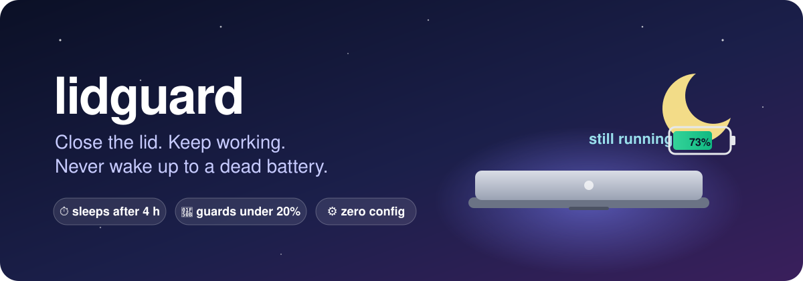
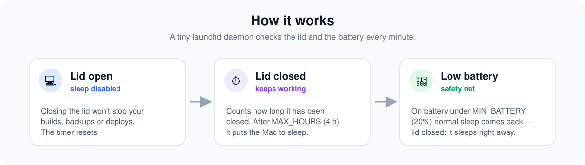
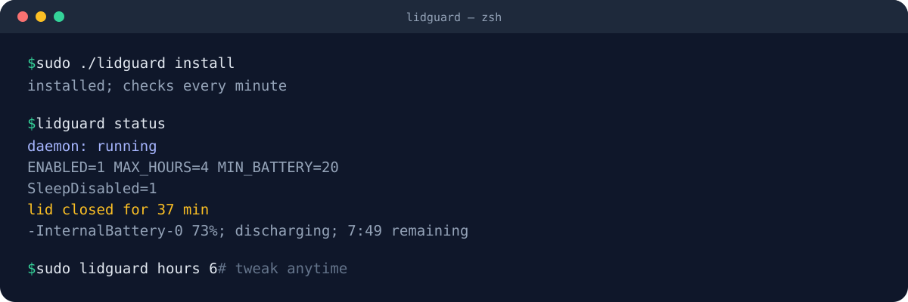

<p align="center">
  
</p>

# lidguard

**Close your MacBook and keep working: builds, backups and deploys keep running. lidguard puts the Mac to sleep when it has been closed too long or the battery runs low.**

macOS normally sleeps the moment the lid closes. You can turn that off with `pmset disablesleep 1`, but then nothing stops a closed laptop in a backpack from running until the battery is empty. lidguard handles both cases.

<p align="center">
  
</p>

## Why

You start something long on your laptop: a database backup, a deploy, a big build, a model download, a sync. Then you have to leave. You close the lid, put it in your bag, and either:

- 😴 **macOS sleeps** and your job dies halfway, or
- 🔥 **you disabled sleep** and the laptop runs hot in your bag until it's at 0%.

lidguard sits in between. **Closing the lid doesn't stop your work, but the Mac doesn't stay awake forever.** You get a few hours of lid-closed runtime, and the battery never drops below a floor you choose.

### Good for

- 🗄️ Long `pg_dump` / backup / restore jobs that would break on sleep
- 🚀 Deploys, migrations and CI babysitting from your laptop
- 🤖 AI agents, coding assistants and scripts that keep working while you move
- 📦 Large downloads, uploads, `rsync`, Time Machine to a network drive
- 🧪 Test suites, benchmarks and overnight renders with a safe cutoff

### Compared to the alternatives

| | Lid closed keeps running | Stops on its own | Protects the battery | No GUI app needed |
|---|:---:|:---:|:---:|:---:|
| Default macOS | ❌ | — | ✅ | ✅ |
| `caffeinate` | ❌ (the lid still sleeps the Mac) | ✅ | ❌ | ✅ |
| `pmset disablesleep 1` | ✅ | ❌ | ❌ | ✅ |
| Menu bar keep-awake apps | ⚠️ depends on the app | ⚠️ | ⚠️ | ❌ |
| **lidguard** | ✅ | ✅ after `MAX_HOURS` | ✅ under `MIN_BATTERY` | ✅ |

## Features

- **Lid-closed timer.** The Mac stays awake with the lid shut for up to `MAX_HOURS` (default 4 h), then goes to sleep.
- **Battery safety net.** On battery, below `MIN_BATTERY` (default 20%), normal sleep comes back. If the lid is closed, the Mac sleeps right away.
- **Resets when you open the lid.** Opening the lid starts the timer over, so a quick check doesn't count against the next close.
- **Small and readable.** One bash script and one launchd plist. No app to keep open, no menu bar icon, no dependencies.
- **Logged.** Every action goes to `/var/log/lidguard.log`.

## Install

```sh
git clone https://github.com/agudeluca/lidguard.git
cd lidguard
sudo ./lidguard install
```

<p align="center">
  
</p>

## Usage

| Command | What it does |
|---|---|
| `lidguard status` | Daemon state, config, how long the lid has been closed, battery |
| `sudo lidguard hours 6` | Sets the maximum lid-closed time |
| `sudo lidguard battery 30` | Sets the low-battery threshold |
| `sudo lidguard off` / `on` | Gives sleep back to macOS / lets lidguard manage it again |
| `lidguard log` | Shows the latest actions |
| `sudo ./lidguard uninstall` | Removes everything and restores normal sleep |

The config is in `/etc/lidguard.conf`:

```sh
ENABLED=1
MAX_HOURS=4
MIN_BATTERY=20
```

## How it works

`/Library/LaunchDaemons/com.lidguard.plist` runs `/usr/local/libexec/lidguard.sh` as root every 60 seconds. Each run:

1. Reads the lid state (`ioreg AppleClamshellState`) and the battery (`pmset -g batt`).
2. If the lid is open: sets `pmset disablesleep 1`, unless the battery is low, and resets the timer.
3. If the lid is closed: records when it was closed. Once `MAX_HOURS` have passed, or the battery drops below `MIN_BATTERY`, it sets `disablesleep 0` and runs `pmset sleepnow`.

### Test it without root

```sh
LIDGUARD_TEST=1 LID=closed POWER=battery PCT=15 STATE_DIR=/tmp/lg CONF=/dev/null LOG=/dev/stdout ./lidguard.sh
```

## FAQ

**Does it work on Apple Silicon and Intel?**
Yes. It only uses `pmset`, `ioreg` and `launchd`, which ship with macOS.

**Does it stay on after a reboot?**
Yes. The launchd daemon starts at boot and applies your config.

**What happens when I open the lid after it went to sleep?**
The Mac wakes as usual, the timer resets, and closing the lid keeps it running again.

**Does it change anything else in my power settings?**
No. It only toggles `disablesleep` and runs `pmset sleepnow` when it trips. `uninstall` puts `disablesleep` back to `0`.

**Why does it need root?**
`pmset disablesleep` requires it. The script is about 100 lines of bash, so you can read every line before installing.

## Caveats

- With an external display and the lid closed (clamshell mode), the `MAX_HOURS` limit still applies. If you work that way, run `sudo lidguard off` or raise `hours`.
- Ventilation is your job: don't run heavy work in a closed laptop inside a bag.

## License

MIT
